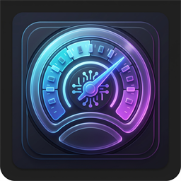

<p align="center">
  
</p>

<h1 align="center">MedidorTokens para Antigravity IDE (v0.1.1)</h1>

<p align="center">
  Extensão para monitoramento em tempo real do consumo de tokens de Inteligência Artificial e cotas de uso (<code>5h</code> / <code>7d</code>) no <strong>Antigravity IDE 2.6.0+</strong>.
</p>

---

## Visão Geral

- **Versão atual:** `0.1.1`
- **Nome de exibição:** `MedidorTokens`
- **Identificador da extensão:** `rogeriocenteno.medidortokens`
- **Autor / Mantenedor:** Rogério Centeno ([`rogeriocenteno`](https://github.com/rogeriocenteno))
- **Idioma oficial:** Português do Brasil (`pt-BR`)
- **Fuso horário:** `America/Sao_Paulo` (`UTC-3`)
- **Licença:** [MIT](./LICENSE)
- **Open VSX Registry:** [`rogeriocenteno.medidortokens`](https://open-vsx.org/extension/rogeriocenteno/medidortokens)
- **Release Oficial (GitHub):** [`v0.1.1`](https://github.com/rogeriocenteno/MedidorTokens/releases/tag/v0.1.1)

Na versão 2.6.0 do Antigravity IDE, a substituição do processo legado `language_server_windows_x64.exe` pelo serviço nativo em background fez a extensão base original (`pqub.altimeter` `0.0.4`) falhar com `Language Server not found`. Este projeto cria e mantém o **MedidorTokens**, corrigindo o núcleo de leitura para ler diretamente os logs `transcript.jsonl` em `~/.gemini/antigravity/brain/` e adicionando 12 etapas completas de monitoramento de tokens, cotas e estatísticas.

---

## Recursos Implementados

- **Compatibilidade Antigravity IDE 2.6.0+:** Streaming incremental direto dos arquivos `~/.gemini/antigravity/brain/<cascade-id>/.system_generated/logs/transcript.jsonl`.
- **Detalhamento Completo de Tokens:** Separação visual entre **Entrada Nova** e **Lido do Cache**, **Tokens de Saída**, **Chamadas de API**, **Eficiência de Cache** e **Contexto Atual** com destaque por faixa (`<120K`, `120K–180K`, `>=180K`).
- **Janelas & Cotas (`5h` / `7d`) com Coleta Automática (`🔄 Auto`):**
  - Sincronização em segundo plano com o servidor local do Antigravity IDE (`google.google-antigravity` / `LanguageServerService` via `GetUserStatus` e `RetrieveUserQuotaSummary`) para obter conta ativa, plano, `% Restante` e horário de renovação (`resetAt`).
  - Agrupamento por família: **Gemini Models**, **Claude and GPT models** e **Gemini 4 Argon / Orchestrator** (incluindo suporte ao modelo `Orchestrator (Argon)` / `gemini-pro-orchestrator-g1-pro`).
  - Estimativa dinâmica de desgaste em tempo real entre sincronizações e reciclagem contínua de ciclo.
- **Suporte a Planos Pro e Starter Free:** Alternância rápida (`★ Pro` ↔ `⚡ Starter (Free)`), interface adaptativa por plano, ajuste manual (`⚙ Cotas`) e gestão multi-conta (`+` / `×`).
- **Seletor de Sessões com Cache em Memória:** Alternância instantânea entre **Sessão Atual (Ativa)**, **Hoje (Todas as Sessões)** e histórico de sessões, com checagem leve a cada 10 segundos.
- **Barra de Status Inferior (`Status Bar`):** Contador contínuo no rodapé da IDE desacoplado da visibilidade do painel lateral.
- **Cores Dinâmicas & Legendas DOM:** Paleta automática exclusiva para novos modelos e legendas HTML visíveis nos gráficos de pizza.
- **Dashboard Histórico & Exportação CSV:** Gráficos de barras empilhadas, filtros de período (`8`, `15`, `30`, `90` dias ou `Todo o histórico`), datas no padrão brasileiro `DD/MM/AAAA` (`UTC-3`) e exportação `.csv` (`UTF-8 com BOM`, separador `;`).

---

## Como Instalar

### Opção 1: Instalar via Open VSX Registry / Extensions da IDE
1. No Antigravity IDE (ou outra IDE compatível com Open VSX), abra **Extensions** (`Ctrl + Shift + X`).
2. Pesquise por **`MedidorTokens`** ou **`rogeriocenteno.medidortokens`** (página oficial em [`open-vsx.org/extension/rogeriocenteno/medidortokens`](https://open-vsx.org/extension/rogeriocenteno/medidortokens)).
3. Clique em **Install** e recarregue a janela se necessário (`Ctrl + Shift + P` → **`Developer: Reload Window`**).

### Opção 2: Instalar via `.vsix` (Release Oficial ou Local)
1. Baixe [`medidortokens-0.1.1-agy2.6-fix.vsix`](./medidortokens-0.1.1-agy2.6-fix.vsix) (ou na [Release v0.1.1](https://github.com/rogeriocenteno/MedidorTokens/releases/tag/v0.1.1)).
2. No Antigravity IDE, abra **Extensions** (`Ctrl + Shift + X`).
3. Clique em **`...`** → **`Install from VSIX...`** e selecione o arquivo `.vsix`.
4. Pressione `Ctrl + Shift + P` e execute **`Developer: Reload Window`**.

### Opção 3: Script Batch (Windows)
1. Execute [`instalar_correcao_altimeter.bat`](./instalar_correcao_altimeter.bat) após instalar/possuir a pasta da extensão em `%USERPROFILE%\.antigravity-ide\extensions\`.
2. Recarregue a janela com **`Developer: Reload Window`**.

### Opção 4: Empacotar localmente a partir do repositório
```powershell
node -c "./dist_altimeter_corrigido/extension.js"
node "./gerar_pacote.js"
```

---

## Estrutura do Repositório

```text
.
├── README.md                           # Documentação principal do repositório
├── LICENSE                             # Licença MIT
├── LEIA-ME.md                          # Guia rápido de instalação em pt-BR
├── Inicio.md                           # Visão técnica e fluxo de manutenção
├── Plano_Melhorias.md                  # Registro detalhado das 12 etapas
├── Git_Implantacao_GitHub.md           # Guia de implantação inicial do repositório GitHub
├── Git_Rotina_Versionamento.md         # Rotina diária de commits, branches e main
├── medidortokens-0.1.1-agy2.6-fix.vsix # Pacote instalador oficial v0.1.1
├── gerar_pacote.js                     # Script Node.js gerador do .vsix (zlib nativo)
├── instalar_correcao_altimeter.bat     # Instalador rápido para Windows
└── dist_altimeter_corrigido/
    ├── extension.js                    # Bundle principal da extensão v0.1.1
    ├── icon.png                        # Ícone oficial (256x256 PNG)
    └── Pub_OpenVSX.md                  # Guia oficial de publicação no Open VSX Registry
```

---

## Privacidade e Segurança

- **100% Local:** Todos os cálculos, leituras de log e agregações ocorrem localmente no computador do usuário.
- **Sem Telemetria Externa:** Nenhuma chamada externa é realizada pela extensão; a coleta de cotas consulta apenas o serviço local da IDE (`127.0.0.1`).
- **Sem Dependências de CDN:** Webviews utilizam apenas `chart.min.js` empacotado localmente.

---

## Créditos e Licença

- **Autoria e manutenção (v0.1.0+):** Rogério Centeno ([`rogeriocenteno`](https://github.com/rogeriocenteno))
- **Base original:** Projeto open source [Altimeter (`pqub/altimeter`)](https://github.com/pqub/altimeter) (v0.0.1–v0.0.4), licenciado sob MIT.
- **Licença:** [MIT](./LICENSE)
